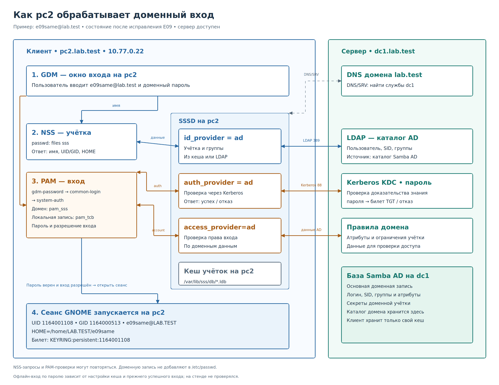
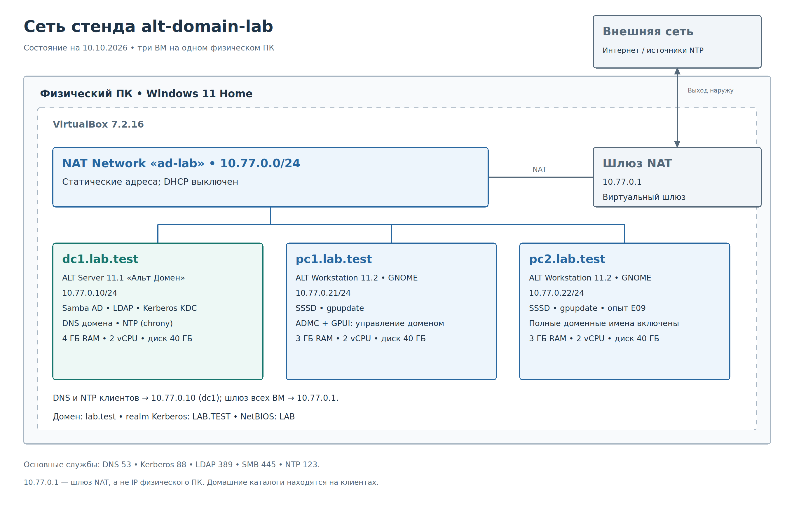

# Как локальный и доменный пользователь входят в ALT Linux

Основной пример — pc2 после E09, по материалам 9–10 октября 2026 года. В конце добавлено наблюдение об отключении записи в E04 от 24 ноября.

## Короткий ответ для преподавателя

В нашем стенде используется клиент-серверная аутентификация. Доменная учётная запись хранится на контроллере dc1 в каталоге Samba AD. При онлайн-входе клиент pc2 через PAM и SSSD выполняет Kerberos-аутентификацию с KDC на dc1. Сервер проверяет доказательство знания доменного пароля и выдаёт билет. После проверки пароля и права входа рабочая станция сама запускает графический сеанс с доменными UID и группами.

Доменного пользователя не нужно создавать командой useradd, и его запись не копируется в /etc/passwd. Сведения о нём Linux получает через NSS и SSSD из домена или локального кеша SSSD. Домашний каталог и запущенные программы при этом находятся на клиентской ВМ.

Это не означает, что пароль обязательно проверяется сервером при каждом обращении: SSSD отдельно кеширует сведения об учётках. Проверка пароля без сервера также возможна при соответствующей настройке и ранее успешном входе, но такой сценарий в нашем стенде ещё не проверен.

## 1. Что происходит при доменном входе

1. Пользователь вводит в GDM на pc2 полное имя e09same@lab.test и доменный пароль.
2. Система выясняет, какой записи соответствует имя. NSS — механизм поиска сведений об учётках. Для passwd в нашем nsswitch.conf задано `files sss`: локальные записи берутся из /etc/passwd, доменные — через библиотеку NSS для SSSD. SSSD возвращает имя, UID/GID, домашний каталог и оболочку. Данные могут быть получены из кеша; при необходимости SSSD обновляет их через LDAP на dc1.
3. GDM выполняет правила PAM. В нашем стеке путь проходит через gdm-password → common-login → system-auth. Маршрутизатор system-check-localuser направляет доменного пользователя с наблюдаемым высоким UID в system-auth-sss-only. Модуль pam_sss передаёт запрос локальному SSSD. Для локальной записи используется system-auth-local-only с pam_tcb.
4. При обычной онлайн-проверке доменного пароля SSSD с `auth_provider = ad` использует Kerberos и обращается к KDC контроллера dc1. Из пароля на клиенте получается криптографический ключ; протокол позволяет подтвердить знание пароля. Сам введённый пароль не отправляется серверу открытым текстом. При успехе клиент получает TGT — билет для дальнейшего получения билетов к доменным службам.
5. Отдельно проверяется право входа: PAM выполняет стадию account, а у SSSD задан `access_provider = ad`. Правильного пароля самого по себе недостаточно: ограничения учётной записи и правила доступа тоже могут запретить вход. Подробную трассировку всех проверок доступа в этом опыте мы не выполняли.
6. После разрешения входа клиент открывает сеанс GNOME, задаёт UID/GID и дополнительные группы, HOME и окружение. Ядро проверяет доступ процессов к файлам по числовым идентификаторам. Доменный билет в нашем проверенном сеансе находится в пользовательском хранилище KEYRING, а рабочий стол выполняется на pc2.

Это схема обязанностей компонентов, а не точная трасса вызовов: NSS-запросы и PAM-проверки могут повторяться и выполняться на разных этапах входа. NSS сообщает, кто пользователь; PAM с SSSD проверяет пароль и право входа; программа входа создаёт сеанс.

UID/GID — Linux-представление доменного пользователя, которое возвращает SSSD. В AD пользователь имеет SID; провайдер AD по умолчанию сопоставляет SID с числовыми UID/GID. Это не требует добавления строки в /etc/passwd. Настройку ldap_id_mapping на нашем клиенте отдельным выводом не подтверждали, поэтому в отчёте фиксируются наблюдаемые UID/GID, без утверждения о точном расчёте.

Основание общего механизма: [архитектура SSSD](https://sssd.io/docs/architecture.html), [провайдер AD](https://sssd.io/docs/ad/ad-provider.html), [получение билетов Kerberos](https://web.mit.edu/kerberos/krb5-latest/doc/user/tkt_mgmt.html). Конкретный стек PAM, UID, HOME и KEYRING подтверждены выводами стенда 9 октября.

## 2. Где что хранится

Данные                                                                              | Место                    | Что это означает
------------------------------------------------------------------------------------|--------------------------|-----------------
Основная доменная запись: логин, SID, группы, атрибуты и секреты для аутентификации | Каталог Samba AD на dc1  | Сервер — основной источник доменных учёток. Полный путь базы Samba в этом опыте отдельно не проверялся.
Сведения о локальном e09same                                                        | /etc/passwd на pc2       | UID 1001, основной GID 1001, HOME /home/e09same. Это отдельная локальная запись.
Локальный пароль                                                                    | Защищённое хранилище TCB на pc2 | В показанном PAM-стеке используется pam_tcb с write_to=tcb. В /etc/passwd пароль не хранится: поле `x` указывает на отдельное хранилище.
Кеш известных SSSD доменных пользователей и групп                                   | /var/lib/sss/db/ на pc2, файлы cache_*.ldb | Локальная база SSSD. Существование точного файла cache_LAB.TEST.ldb на pc2 отдельно не выводилось; путь и шаблон приведены по документации SSSD.
Данные для офлайн-проверки пароля, если разрешено кеширование                       | Кеш SSSD на клиенте | При cache_credentials=true SSSD может сохранять хеш пароля для последующего входа. Это не запись в /etc/passwd и не копия всей базы AD.
Kerberos-билеты проверенного доменного сеанса                                       | KEYRING:persistent:1164001108 на pc2 | Временные билеты пользователя; их показывает klist. Билет и кеш пароля SSSD — разные вещи.
Файлы пользователя и настройки рабочего стола                                       | /home/LAB.TEST/e09same на pc2 | Локальный домашний каталог этой ВМ. Такой же путь на другой ВМ не означает общие файлы.
Конфигурация источников данных и проверки входа                                     | /etc/nsswitch.conf, /etc/sssd/sssd.conf, /etc/pam.d/ на pc2 | Правила подключения и обработки, а не список всех доменных пользователей.

Кеш может содержать только уже запрошенные учётки. Успех `getent passwd e09same@lab.test` означает, что запись удалось получить через NSS; он не доказывает её наличие в /etc/passwd и не проверяет пароль. Источник можно разделить командами `getent -s files passwd ...` и `getent -s sss passwd ...`.

Кеш данных описан в [документации SSSD backend](https://sssd.io/troubleshooting/backend.html). Настройка cache_credentials и хранение хеша описаны в [sssd.conf(5) версии 2.9.8](https://github.com/SSSD/sssd/blob/2.9.8/src/man/sssd.conf.5.xml), соответствующей проверенной версии SSSD на pc2. Наличие такого хеша на нашем клиенте не проверялось.

## 3. Что происходит, если dc1 недоступен

Поиск сведений об уже известной доменной учётке может обслуживаться из локального кеша SSSD. Это ещё не означает, что офлайн-вход по паролю разрешён.

Для офлайн-входа по паролю нужны разрешённое кеширование учётных данных, ранее успешная онлайн-аутентификация этого пользователя и соблюдение сроков/ограничений кеша и доступа. Само наличие строки в getent или домашнего каталога этих условий не подтверждает. Во время недоступности KDC получить новый TGT от него нельзя; ранее выданные билеты имеют собственный срок действия.

В присланных выводах мы не проверяли значения cache_credentials, cached_auth_timeout и offline_credentials_expiration и не проводили вход с отключённым dc1. Поэтому в отчёте подтверждён обычный доменный вход, а офлайн-вход остаётся отдельной проверкой.

## 4. Как сейчас различаются тёзки на pc2

Имя для входа    | Источник                  | UID / основной GID      | HOME
-----------------|---------------------------|-------------------------|-----------------------
e09same          | Локальная запись pc2      | 1001 / 1001             | /home/e09same
e09same@lab.test | Домен LAB.TEST через SSSD | 1164001108 / 1164000513 | /home/LAB.TEST/e09same

На pc2 включено `use_fully_qualified_names = true`. SSSD возвращает полное доменное имя e09same@LAB.TEST, которое сохраняет доменную часть при дальнейшей обработке. Поэтому система различает его и локальное e09same. Разница регистра lab.test / LAB.TEST в проверенном примере не создаёт вторую учётку.

В опыте до исправления журнал подтверждал успешную pam_sss-аутентификацию e09same@lab.test, после которой был создан сеанс с локальным UID 1001. Влияние канонизации короткого имени — рабочее объяснение этого перехода; точный внутренний вызов, изменивший выбор UID, не трассировался. После исправления отдельно подтверждены правильные доменный и локальный сеансы.

Связь роли `domain users@LAB.TEST:users` назначает доменным пользователям обычные дополнительные локальные группы. Она не хранит доменный пароль и не отвечает за различение тёзок.

## 5. Сеть стенда

Узел           | Назначение                                                     | IP
---------------|----------------------------------------------------------------|--------------
dc1.lab.test   | ALT Server 11.1 «Альт Домен»: Samba AD, DNS, Kerberos KDC, NTP | 10.77.0.10/24
pc1.lab.test   | ALT Workstation 11.2 GNOME: SSSD, ADMC, GPUI, gpupdate         | 10.77.0.21/24
pc2.lab.test   | ALT Workstation 11.2 GNOME: SSSD, gpupdate, E09 с тёзками      | 10.77.0.22/24
VirtualBox NAT | Виртуальный шлюз сети ad-lab                                   | 10.77.0.1

Все три ВМ работают на одном ПК с Windows 11 Home и VirtualBox 7.2.16. Сеть ad-lab — NAT Network 10.77.0.0/24, адреса статические, DHCP выключен. Оба клиента используют dc1 как DNS и NTP. dc1 синхронизируется с внешними источниками времени. IP 10.77.0.1 принадлежит виртуальному шлюзу, а не физическому ПК.

На pc1 полные доменные имена принудительно не включались. Изменение после E09 относится к pc2. На схеме показаны основные порты служб; это не полный список портов Samba AD и не инструкция для межсетевого экрана.

Редактируемые схемы: [сеть .dia](../presentation/diagrams/network-topology.dia) и [доменный вход .dia](../presentation/diagrams/domain-login.dia).

## 6. Новый вход и действующий сеанс в E04

После отключения `e04test` контроллер отклонил новый запрос начального билета с pc1, и GDM на pc1 не открыл новый сеанс. Уже открытый терминал на pc2 продолжал работать под тем же UID и с тем же PID оболочки. `klist` прочитал из кеша билет, выданный до отключения. В таком сеансе результат `klist` не говорит, выдаёт ли контроллер новые билеты или примет ли существующий билет сетевая служба.

После обратного включения новые входы и свежие TGT подтверждены на обоих клиентах. [Протокол E04](../experiments/e04-domain-account-disable.md) отделяет это наблюдение от офлайн-входа и доступа к сетевым службам, которые не проверялись.
