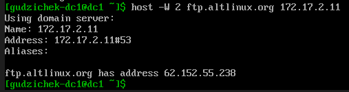
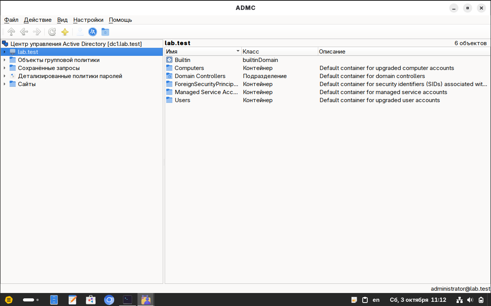
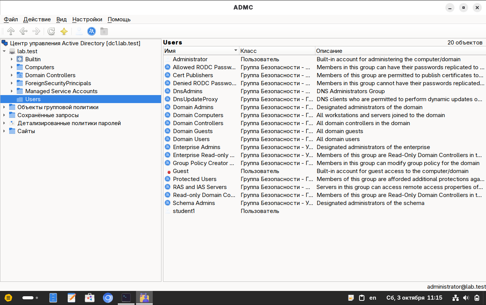
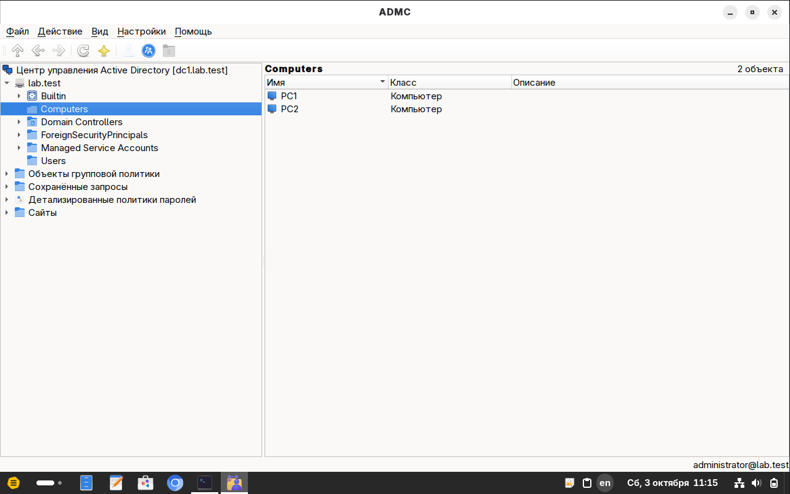
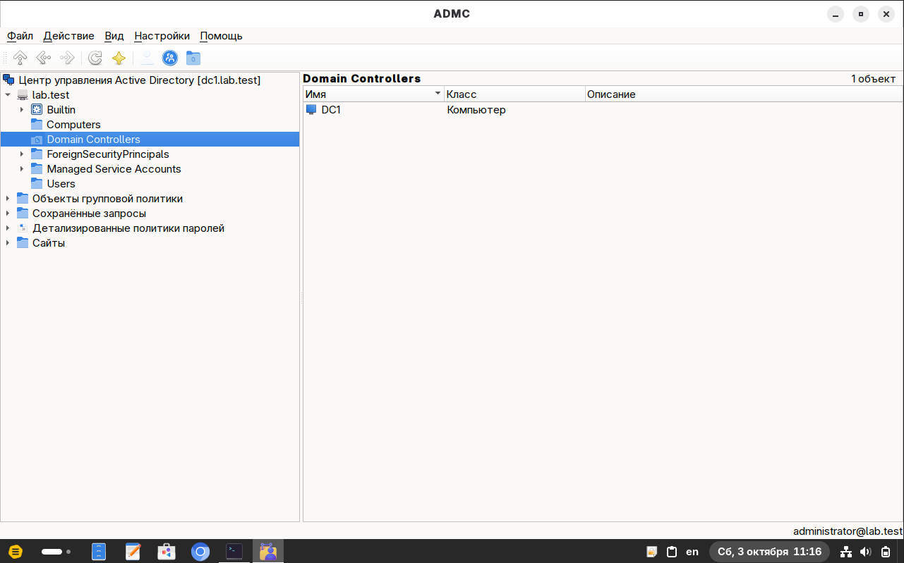

# Подтверждения за 3 октября 2026 года

Подборка фиксирует проверку внешнего DNS и подключение ADMC к уже работающему домену. Создание student2 и lab-students относится к 9 октября и находится в [следующей подборке](../09-10-2026/README.md).

## Список файлов

Файл                                                           | Что показано
---------------------------------------------------------------|---------------------------------
[01-dc1-external-dns-check.png](01-dc1-external-dns-check.png) | Проверка доступного внешнего DNS
[02-admc-connected.png](02-admc-connected.png)                 | Подключение ADMC
[03-admc-users-student1.png](03-admc-users-student1.png)       | Пользователь student1
[04-admc-computers.png](04-admc-computers.png)                 | Клиенты PC1 и PC2
[05-admc-domain-controller.png](05-admc-domain-controller.png) | Контроллер DC1

Имена файлов упорядочены по последовательности действий. Изображения перенесены без изменения содержимого. Время в имени исходного файла и часы внутри ВМ могут различаться; кадры описывают состояния на момент своих проверок.

## Текстовый результат

[pc1-dns-admc-check.txt](pc1-dns-admc-check.txt) содержит переданный при проверке текст: успешное разрешение внешнего имени через dc1, загрузку списков пакетов, версию ADMC 0.24.0 и билет Administrator@LAB.TEST. Это сохранённый результат предыдущего этапа.

По текстовому результату и записи последовательности внешний DNS на dc1 был заменён на 172.17.2.11. Отдельного скриншота изменения smb.conf в этой подборке нет. Сам первый кадр подтверждает прямой ответ этого DNS-сервера.

Показанные объекты ADMC согласуются с ранее полученным списком компьютерных учётных записей на dc1; [результат списка](../01-10-2026/dc1-computers.txt) сохранён в предыдущей подборке.

## Скриншоты

### 1. Проверка доступного внешнего DNS

На dc1 прямой запрос к 172.17.2.11 возвращает адрес ftp.altlinux.org. Этот кадр подтверждает ответ выбранного upstream; изменение smb.conf описано по сохранённому текстовому результату.

### 2. Подключение ADMC

ADMC отображает dc1.lab.test и корень lab.test; в строке состояния указан administrator@lab.test.

### 3. Пользователь student1

В контейнере Users виден student1. Надпись «20 объектов» включает пользователей и группы.

### 4. Клиенты PC1 и PC2

В контейнере Computers отображаются обе клиентские компьютерные учётные записи.

### 5. Контроллер DC1

DC1 находится в подразделении Domain Controllers, отдельно от клиентских компьютеров.

