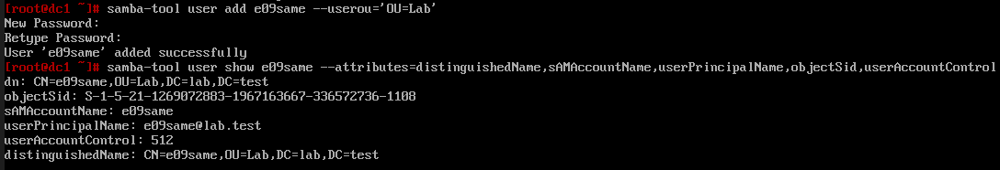
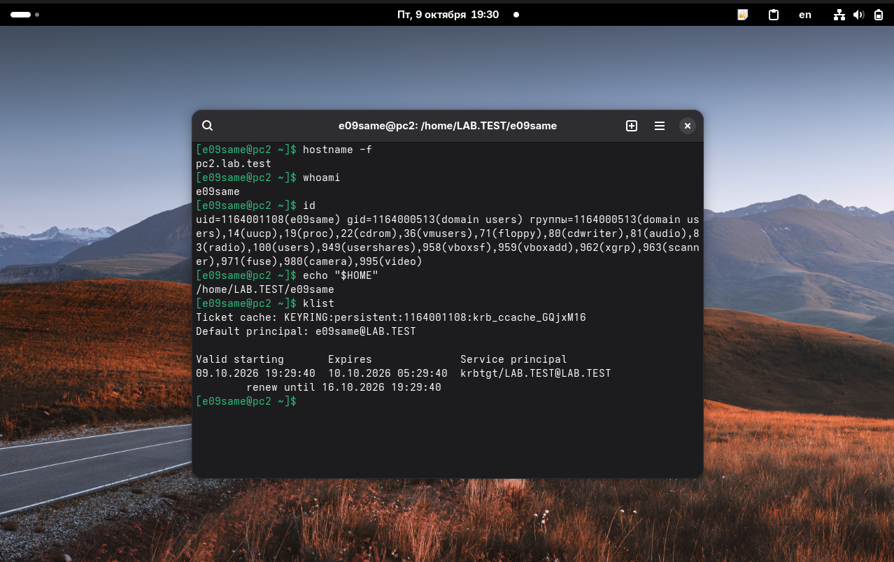
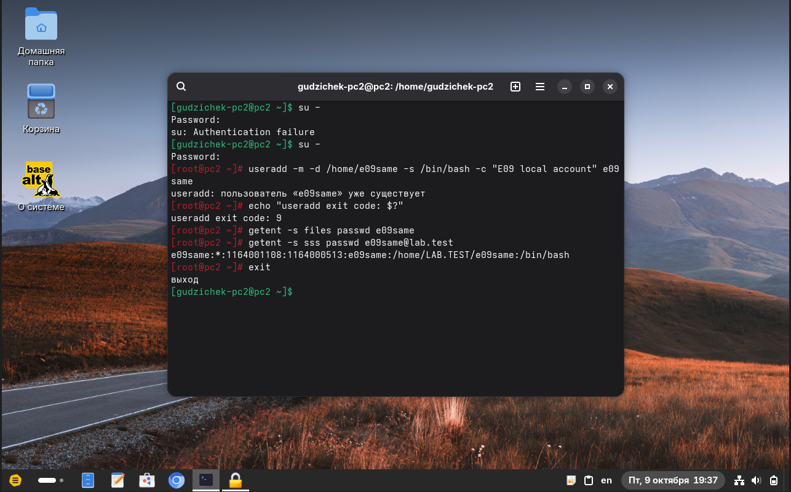
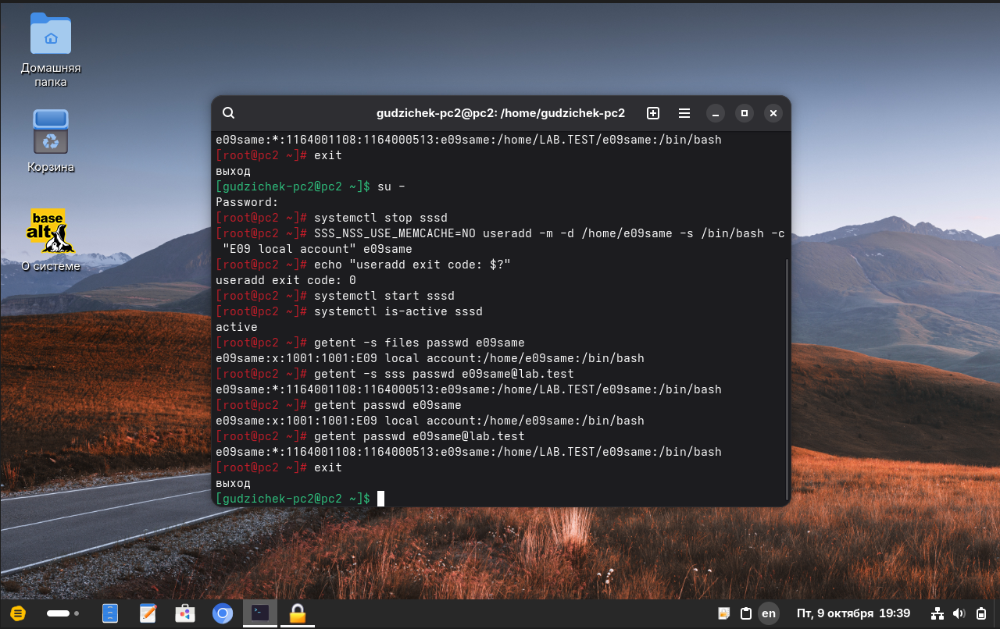
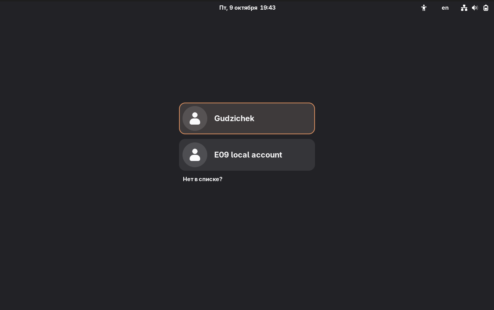
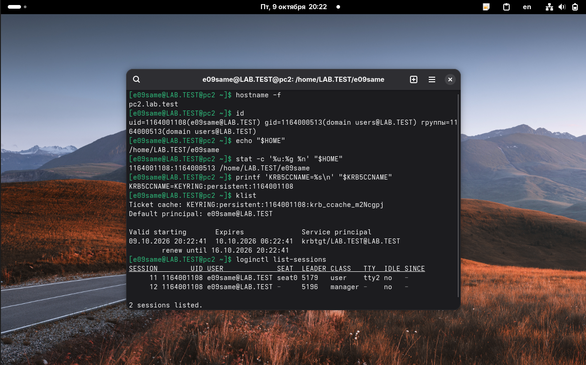
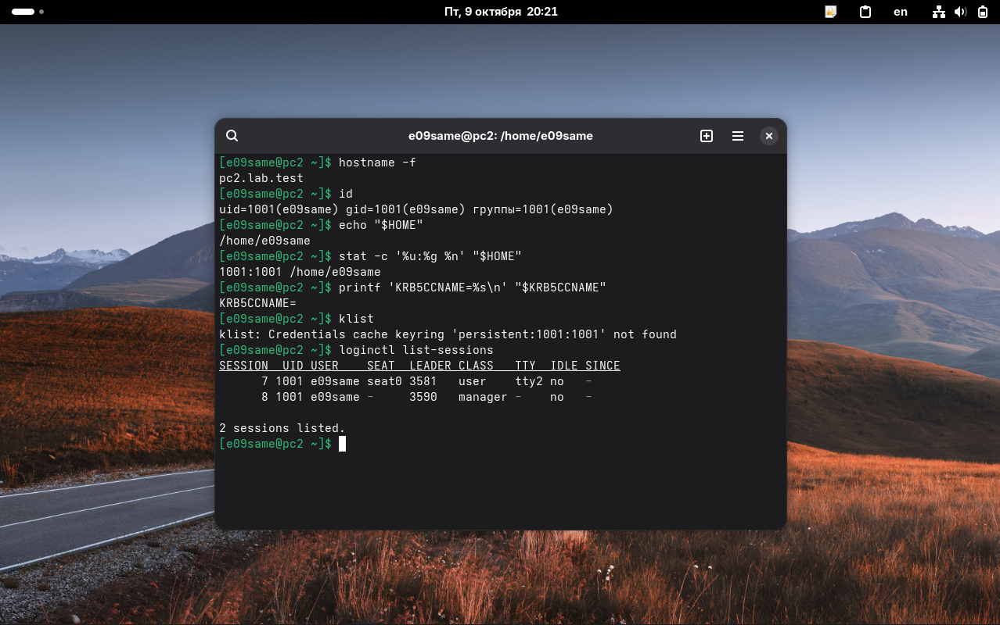
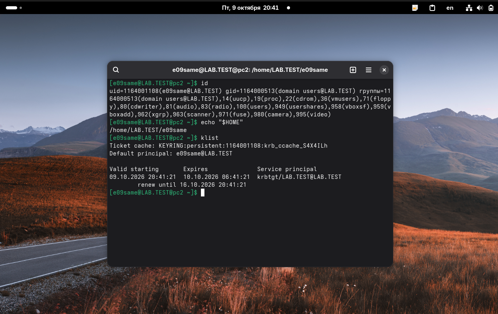
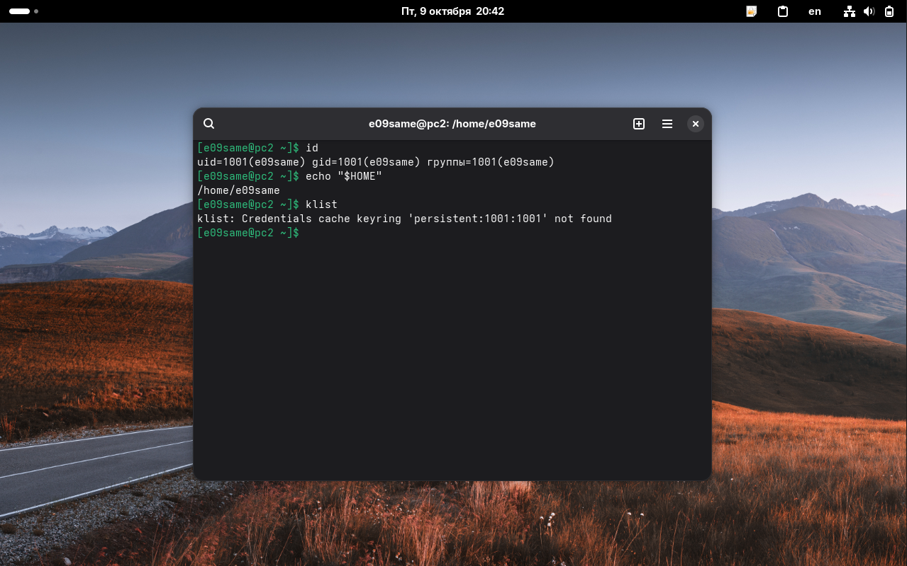
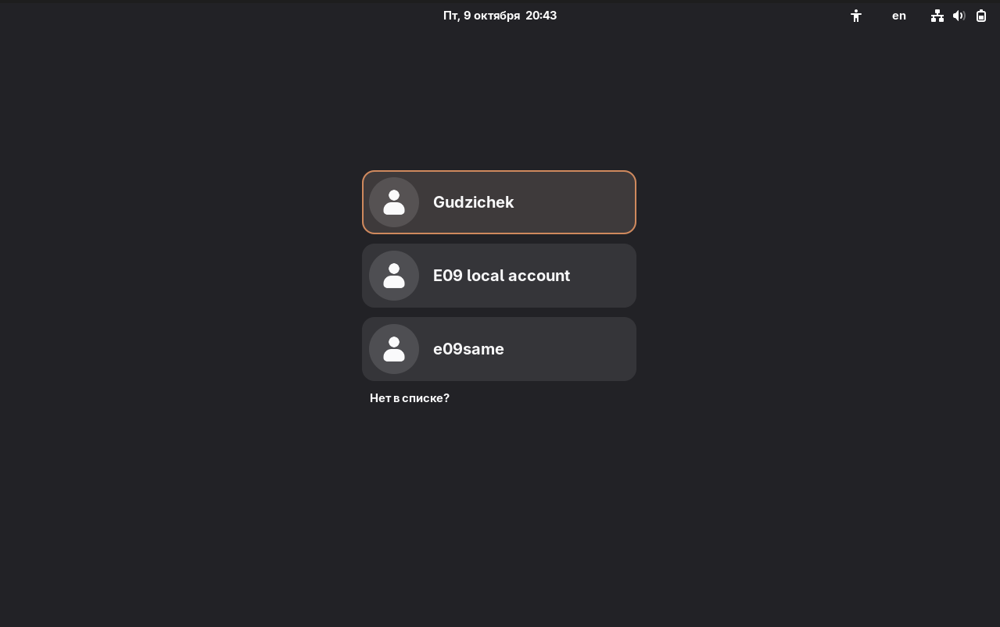

# Подтверждения за 9 октября 2026 года

Подборка фиксирует E02 и E09. **E02 выполнен успешно на двух клиентах:** создание объектов через ADMC, сохранённое членство и вход student2. **E09 выполнен на pc2:** коллизия локального и доменного имени воспроизведена; после полных имён SSSD и дополнения обычных ролей отдельные входы проверены. [Протокол E09](../../experiments/e09-local-domain-name-collision.md).

## Список файлов E02

Файл | Что показано
-------------------------------------------------------------------------------|-----------------------------------------
[01-admc-lab-user-dialog.png](01-admc-lab-user-dialog.png)                     | Подразделение Lab и окно пользователя
[02-admc-student2-group-dialog.png](02-admc-student2-group-dialog.png)         | student2 создан; окно новой группы
[03-admc-lab-students-properties.png](03-admc-lab-students-properties.png)     | Сохранённая группа lab-students
[04-admc-member-pending-save.png](04-admc-member-pending-save.png)             | Участник добавлен в открытом окне
[05-dc1-student2-before-membership.png](05-dc1-student2-before-membership.png) | Пользователь до сохранения членства
[06-dc1-group-before-membership.png](06-dc1-group-before-membership.png)       | Группа до сохранения членства
[07-dc1-student2-memberof.png](07-dc1-student2-memberof.png)                   | Членство сохранено: сторона пользователя
[08-dc1-group-member-confirmed.png](08-dc1-group-member-confirmed.png)         | Членство сохранено: сторона группы
[09-pc1-student2-login.png](09-pc1-student2-login.png)                         | Сеанс student2 на pc1
[10-pc2-student2-login.png](10-pc2-student2-login.png)                         | Сеанс student2 на pc2

Имена файлов упорядочены по последовательности действий. Изображения перенесены без изменения содержимого. Время в имени исходного файла и часы внутри ВМ могут различаться; кадры описывают состояния на момент своих проверок.

## Как читать последовательность

Кадры 04-06 показывают промежуточное состояние: пользователь уже добавлен в список открытого окна ADMC, но на сервере членства ещё нет. После сохранения повторные серверные запросы на кадрах 07-08 подтверждают изменение. Для итогового вывода используются именно эти повторные запросы и входы на кадрах 09-10.

Проверка                          | pc1                          | pc2
----------------------------------|------------------------------|-----------------------------
Имя узла                          | pc1.lab.test                 | pc2.lab.test
Пользователь                      | student2                     | student2
UID                               | 1164001106                   | 1164001106
Основная группа                   | domain users, GID 1164000513 | domain users, GID 1164000513
Проверяемая дополнительная группа | lab-students, GID 1164001107 | lab-students, GID 1164001107
Домашний путь                     | /home/LAB.TEST/student2      | /home/LAB.TEST/student2
Principal Kerberos                | student2@LAB.TEST            | student2@LAB.TEST
TGT                               | krbtgt/LAB.TEST@LAB.TEST     | krbtgt/LAB.TEST@LAB.TEST
SSSD                              | active                       | active

Билет на pc1 выдан 09.10.2026 в 11:10:49, на pc2 — в 11:14:04. На скриншотах оба билета действуют. Совпадение домашнего пути само по себе не доказывает общее хранение файлов.

## Текстовые подтверждения E02

* [dc1-e02-key-lines.txt](dc1-e02-key-lines.txt) — ручная расшифровка ключевых строк серверных кадров до и после сохранения.
* [pc1-student2-lookup.txt](pc1-student2-lookup.txt) — ранее переданный текст проверки student2 и lab-students на pc1.
* [pc1-student2-session.txt](pc1-student2-session.txt) — расшифровка результатов сеанса на pc1.
* [pc2-student2-session.txt](pc2-student2-session.txt) — расшифровка результатов сеанса на pc2.
* [pc1-account-sources.txt](pc1-account-sources.txt) — переданный перед E02 текст проверки локальной и доменной записи, NSS/PAM и графической среды. Точная дата этого исходного текста отдельно не указана; он сохранён как контекст следующего опыта E09.

Происхождение отмечено в самих текстовых файлах: расшифровки кадров отделены от переданного текста команд. Исходные изображения сохраняются как подтверждения своих состояний.

Пользователь сообщил о создании снимков после E02 и E09 для всех трёх ВМ. Изображений менеджера новых снимков в этой подборке нет; [сообщённые точки сохранения](vm-snapshots.txt) учитываются отдельно от скриншотов проверок.

## Скриншоты E02

### 1. Подразделение Lab и окно пользователя

Lab уже виден в дереве; в строке состояния есть сообщение о создании. Окно пользователя ещё пустое: этот кадр не подтверждает сохранение student2 или окончательные параметры его пароля.

### 2. student2 создан; окно новой группы

В Lab уже отображается student2. Окно группы пока пустое; выбраны область «Глобальная» и тип «Безопасность».

### 3. Сохранённая группа lab-students

В Lab видны student2 и lab-students. В свойствах группы отображаются область «Глобальная» и тип «Безопасность».

### 4. Участник добавлен в открытом окне

Во вкладке «Участники» уже виден student2, но кнопки «Применить» и «Сбросить» активны. Это промежуточное состояние до подтверждения записи изменений в домен.

### 5. Пользователь до сохранения членства

samba-tool user show student2 показывает DN пользователя в OU=Lab. Строки memberOf ещё нет.

### 6. Группа до сохранения членства

В group show отсутствует member, а group listmembers не выводит участников. Это исходная проверка незавершённого изменения, а не итог E02.

### 7. Членство сохранено: сторона пользователя

Повторный user show содержит memberOf: CN=lab-students,OU=Lab,DC=lab,DC=test.

### 8. Членство сохранено: сторона группы

group show содержит member: CN=student2,OU=Lab,DC=lab,DC=test; group listmembers выводит student2.

### 9. Сеанс student2 на pc1

Видны pc1.lab.test, student2, UID 1164001106, группа lab-students, домашний путь, TGT и SSSD active. После случайного ввода «1. systemctl …» команда выполнена в правильном виде.

### 10. Сеанс student2 на pc2

Видны pc2.lab.test и та же доменная учётная запись с совпадающим UID, группой lab-students, TGT и SSSD active.

## Список новых файлов E09

Файл                                                                                     | Что подтверждает
-----------------------------------------------------------------------------------------|---------------------------------------
[11-dc1-e09same-created.png](11-dc1-e09same-created.png)                                 | Создание доменного e09same в OU=Lab и атрибуты
[12-pc2-e09same-domain-baseline.png](12-pc2-e09same-domain-baseline.png)                 | Контрольный доменный вход до локального тёзки
[13-pc2-e09same-useradd-refused.png](13-pc2-e09same-useradd-refused.png)                 | Отказ useradd, код 9, files пуст, sss возвращает доменного пользователя
[14-pc2-e09same-two-account-sources.png](14-pc2-e09same-two-account-sources.png)         | Успешное создание локального тёзки; разные UID и каталоги
[15-pc2-e09same-login-list-before-fix.png](15-pc2-e09same-login-list-before-fix.png)     | Список GDM до исправления: виден E09 local account
[16-pc2-e09same-auth-session-collision.txt](16-pc2-e09same-auth-session-collision.txt)   | Контрольный сбой после перезагрузки и журнал доменной аутентификации
[17-pc2-e09same-domain-login-fq.png](17-pc2-e09same-domain-login-fq.png)                 | Правильный доменный UID после полных имён, до дополнения ролей
[18-pc2-e09same-local-login-fq.png](18-pc2-e09same-local-login-fq.png)                   | Правильный локальный UID, нет доменного Kerberos-кеша
[19-pc2-e09same-domain-login-with-roles.png](19-pc2-e09same-domain-login-with-roles.png) | Итоговый доменный сеанс с обычными локальными группами ролей и TGT
[20-pc2-e09same-local-login-final.png](20-pc2-e09same-local-login-final.png)             | Итоговый локальный сеанс: UID 1001, только локальная группа, без TGT
[21-pc2-e09same-login-list-after-fix.png](21-pc2-e09same-login-list-after-fix.png)       | Список GDM после исправления: отдельные локальная и доменная карточки

Десять новых PNG скопированы без изменения содержимого. Номер 16 занимает текстовое подтверждение: изображение сбоя не создавалось из текста. Кадры 17 и 18 сгруппированы как доменная и локальная проверки одного состояния; их номера не задают хронологию выдачи билетов.

В переданном архиве также были семь кадров E02 с исходными именами 110211, 110313, 110349, 110441, 110503, 111218 и 111610. Их содержимое побайтно совпало соответственно с уже сохранёнными кадрами 04-10; повторные копии не добавлены.

## Текстовые подтверждения E09

Файл                                                                                     | Происхождение и содержание
-----------------------------------------------------------------------------------------|---------------------------------------
[dc1-e09-key-lines.txt](dc1-e09-key-lines.txt)                                           | Ручная расшифровка кадра 11: создание и выбранные атрибуты доменной записи
[pc2-e09-account-sources.txt](pc2-e09-account-sources.txt)                               | Переданный текст команд: исходные источники NSS, версия/параметры SSSD, подготовка локальной записи
[pc2-e09-pam-stack.txt](pc2-e09-pam-stack.txt)                                           | Переданные правила PAM; поясняющие комментарии файлов опущены; состояние канонизации и conf.d
[16-pc2-e09same-auth-session-collision.txt](16-pc2-e09same-auth-session-collision.txt)   | Переданные команды и выбранные строки журнала до исправления; не расшифровка кадра
[pc2-e09-fq-name-fix.txt](pc2-e09-fq-name-fix.txt)                                       | Переданный текст: резервная копия SSSD, настройка полных имён, первые правильные новые входы
[pc2-e09-role-update-and-final-sessions.txt](pc2-e09-role-update-and-final-sessions.txt) | Переданный текст: роли до/после дополнения и итоговые отдельные сеансы
[vm-snapshots.txt](vm-snapshots.txt)                                                     | Подтверждения пользователя о снимках после E02/E09 и сведения о резервных копиях

Эти материалы — выбранные фрагменты. Они не объявляются полными автоматически выгруженными журналами. Пароли и предложенный утилитой passwd пример в проект не включены.

## Как читать результат E09

Исходный доменный вход на кадре 12 успешен. После создания локальной записи оба источника существуют, но доменная запись SSSD ещё возвращается с коротким полем имени e09same. Список карточек GDM на кадре 15 показывает интерфейс; он не доказывает удаления доменной записи.

Контрольный сбой подтверждён текстом 16: после перезагрузки и полного доменного имени pam_sss зарегистрировал успех, а новый процесс и loginctl показали локальный UID 1001. KRB5CCNAME при этом ссылалась на доменный UID 1164001108. Точное место изменения имени в PAM/NSS не установлено; объяснение канонизацией остаётся гипотезой.

Состояние                      | Доменный вход                                                              | Локальный вход
-------------------------------|----------------------------------------------------------------------------|--------------------
До создания локального тёзки   | UID 1164001108, доменный каталог, TGT                                      | Тестовой записи ещё нет
После создания, до исправления | Контрольный новый вход дал UID 1001 и локальный каталог при успехе pam_sss | UID 1001, но получены дополнительные доменные и локальные группы
После полных имён SSSD         | UID 1164001108, доменный каталог, TGT; только доменная группа              | UID 1001, локальный каталог, только локальная группа; без доменного кеша
После дополнения роли users    | UID 1164001108, TGT и обычные локальные группы роли users                  | UID 1001, только локальная группа; без доменного кеша

Текст первого исправленного доменного входа содержит TGT 20:19:28 и сеансы 3/4. Кадр 17 относится к повторной проверке с TGT 20:22:41 и сеансами 11/12. Итоговый кадр 19 и переданный финальный текст содержат TGT 20:41:21. Эти результаты не объединяются в один сеанс.

Итог E09 подтверждён для pc2. На pc1 коллизия не повторена. Новый графический вход student2 после изменения формата имён и применение GPO не проверялись; его членство lab-students на pc2 сохранилось по запросу id. [Протокол и выводы](../../experiments/e09-local-domain-name-collision.md).

## Скриншоты E09

### 11. Создание доменного e09same

На dc1 samba-tool сообщает об успешном создании пользователя. Атрибуты показывают OU=Lab, UPN e09same@lab.test и userAccountControl 512. В E09 пользователь создан командным инструментом.

### 12. Контрольный доменный вход

До создания локального тёзки процесс использует доменный UID 1164001108 и `/home/LAB.TEST/e09same`. klist показывает TGT e09same@LAB.TEST, выданный в 19:29:40.

### 13. Отказ создания локального тёзки

useradd сообщает о существующем пользователе и коде 9. При этом files не выводит локальной записи, а sss возвращает доменного e09same. Предшествующий отказ первой попытки su на этом кадре не используется как результат E07.

### 14. Две записи из разных источников

После временной остановки SSSD локальное создание завершилось с кодом 0; SSSD снова active. files показывает UID 1001 и `/home/e09same`, sss — UID 1164001108 и `/home/LAB.TEST/e09same`. Полное имя до исправления всё ещё возвращает короткое поле имени e09same.

### 15. Список входа до исправления

В GDM видны Gudzichek и E09 local account. Доменных карточек в этом кадре нет; существование доменных записей проверено отдельно через SSSD.

### 16. Контрольный сбой — текстовое подтверждение

Отдельного изображения в архиве нет. Сохранены [выводы нового сеанса и строки журнала](16-pc2-e09same-auth-session-collision.txt): успех доменной аутентификации при локальном UID, домашнем каталоге и несовместимом UID Kerberos-кеша.

### 17. Правильный доменный вход после полных имён

Пользователь e09same@LAB.TEST, UID 1164001108, доменный каталог и TGT согласованы. В этой проверке до дополнения ролей в id видна только domain users@LAB.TEST.

### 18. Правильный локальный вход после полных имён

UID/GID 1001:1001, каталог `/home/e09same`, KRB5CCNAME пуста, кеш UID 1001 не найден. Доменной дополнительной группы больше нет.

### 19. Итоговый доменный вход с обычными ролями

После явного `domain users@LAB.TEST:users` доменный UID сохраняется, обычные локальные группы роли users присутствуют. TGT выдан в 20:41:21; административная роль этим правилом не назначалась.

### 20. Итоговый локальный вход

UID/GID 1001:1001 и `/home/e09same`; в группах процесса только 1001, Kerberos-кеш этого UID не найден.

### 21. Список входа после исправления

В GDM отдельно отображаются Gudzichek, E09 local account и e09same. Доменная карточка подписана коротким отображаемым именем; правильное разделение подтверждается UID и другими признаками сеансов на кадрах 19-20.

