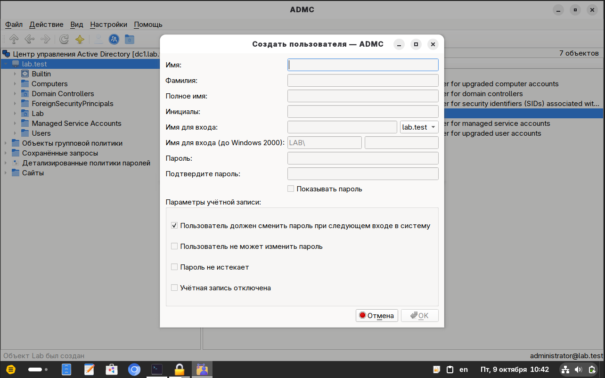
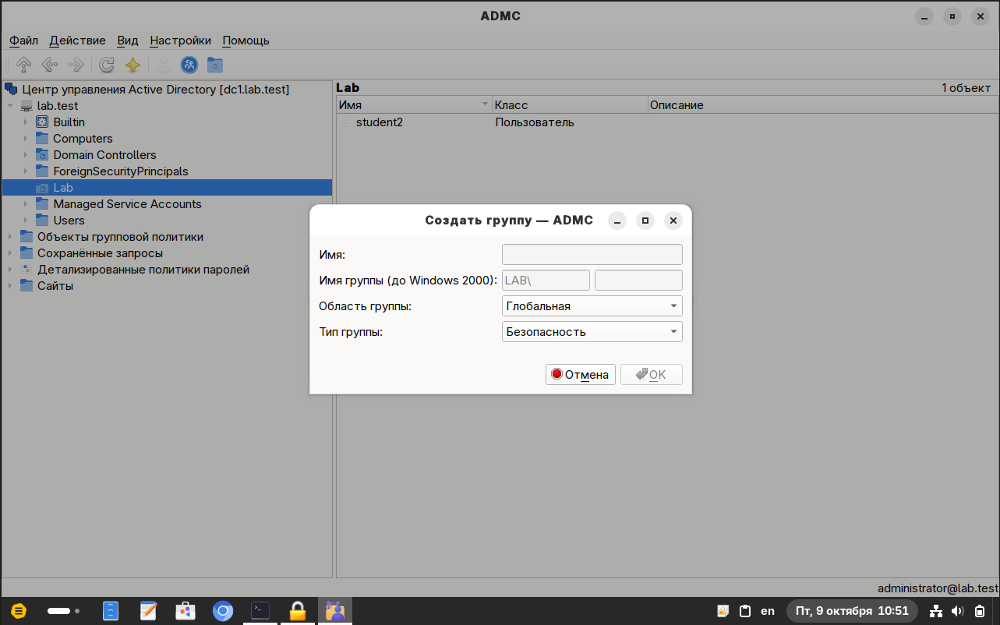
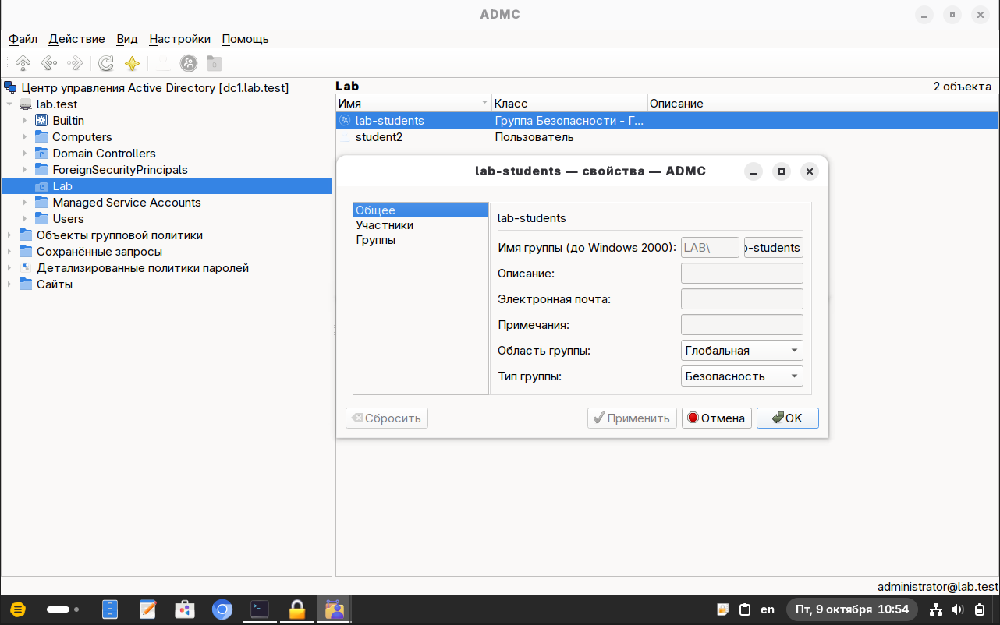
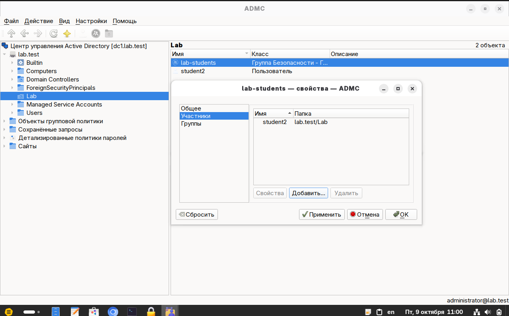
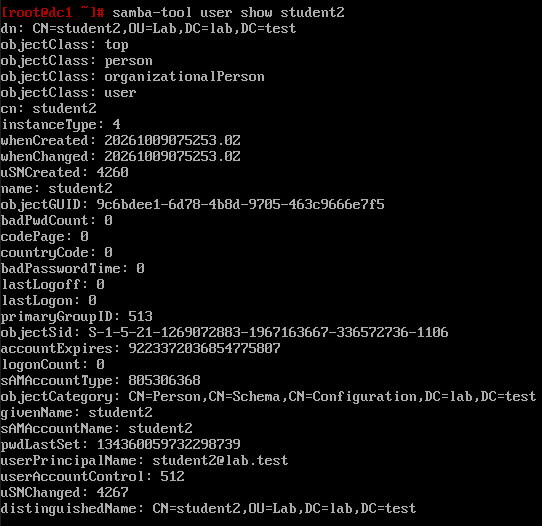
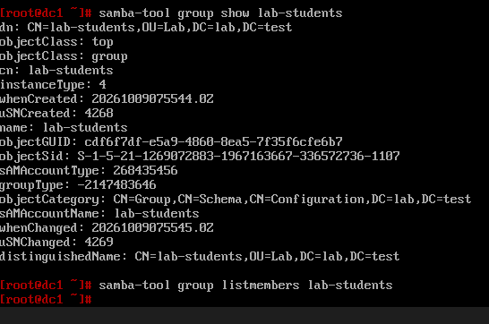
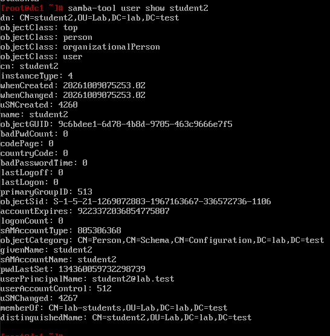
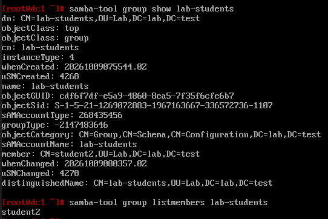
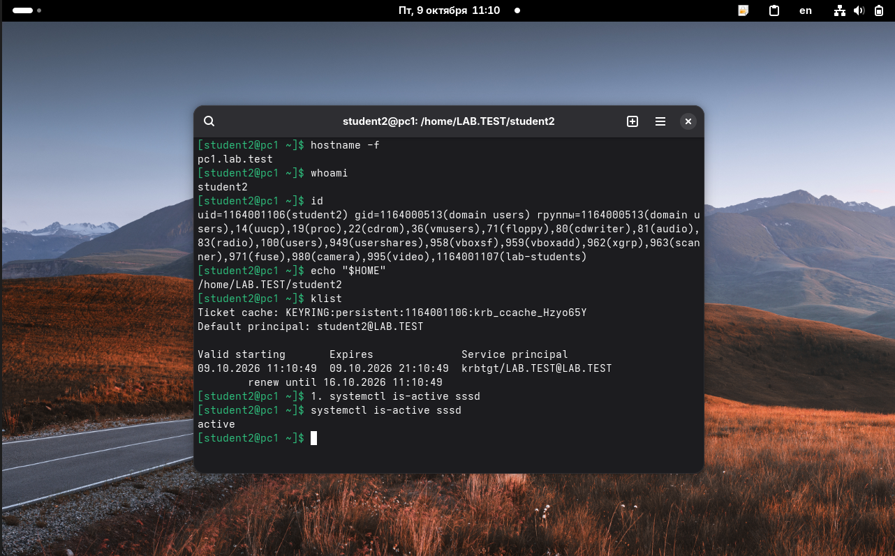

# Подтверждения за 9 октября 2026 года

Подборка фиксирует E02: создание подразделения Lab, пользователя student2, группы lab-students, сохранение членства, серверную проверку и фактический вход на два клиента. **Итог E02 — успешно.**

## Список файлов

Файл | Что показано
-------------------------------------------------------------------------------|-----------------------------------------
[01-admc-lab-user-dialog.png](01-admc-lab-user-dialog.png)                     | Подразделение Lab и окно пользователя
[02-admc-student2-group-dialog.png](02-admc-student2-group-dialog.png)         | student2 создан; окно новой группы
[03-admc-lab-students-properties.png](03-admc-lab-students-properties.png)     | Сохранённая группа lab-students
[04-admc-member-pending-save.png](04-admc-member-pending-save.png)             | Участник добавлен в открытом окне
[05-dc1-student2-before-membership.png](05-dc1-student2-before-membership.png) | Пользователь до сохранения членства
[06-dc1-group-before-membership.png](06-dc1-group-before-membership.png)       | Группа до сохранения членства
[07-dc1-student2-memberof.png](07-dc1-student2-memberof.png)                   | Членство сохранено: сторона пользователя
[08-dc1-group-member-confirmed.png](08-dc1-group-member-confirmed.png)         | Членство сохранено: сторона группы
[09-pc1-student2-login.png](09-pc1-student2-login.png)                         | Сеанс student2 на pc1
[10-pc2-student2-login.png](10-pc2-student2-login.png)                         | Сеанс student2 на pc2

Имена файлов упорядочены по последовательности действий. Изображения перенесены без изменения содержимого. Время в имени исходного файла и часы внутри ВМ могут различаться; кадры описывают состояния на момент своих проверок.

## Как читать последовательность

Кадры 04–06 показывают промежуточное состояние: пользователь уже добавлен в список открытого окна ADMC, но на сервере членства ещё нет. После сохранения повторные серверные запросы на кадрах 07–08 подтверждают изменение. Для итогового вывода используются именно эти повторные запросы и входы на кадрах 09–10.

Проверка                          | pc1                          | pc2
----------------------------------|------------------------------|-----------------------------
Имя узла                          | pc1.lab.test                 | pc2.lab.test
Пользователь                      | student2                     | student2
UID                               | 1164001106                   | 1164001106
Основная группа                   | domain users, GID 1164000513 | domain users, GID 1164000513
Проверяемая дополнительная группа | lab-students, GID 1164001107 | lab-students, GID 1164001107
Домашний путь                     | /home/LAB.TEST/student2      | /home/LAB.TEST/student2
Principal Kerberos                | student2@LAB.TEST            | student2@LAB.TEST
TGT                               | krbtgt/LAB.TEST@LAB.TEST     | krbtgt/LAB.TEST@LAB.TEST
SSSD                              | active                       | active

Билет на pc1 выдан 09.10.2026 в 11:10:49, на pc2 — в 11:14:04. На скриншотах оба билета действуют. Совпадение домашнего пути само по себе не доказывает общее хранение файлов.

## Текстовые подтверждения

* [dc1-e02-key-lines.txt](dc1-e02-key-lines.txt) — ручная расшифровка ключевых строк серверных кадров до и после сохранения.
* [pc1-student2-lookup.txt](pc1-student2-lookup.txt) — ранее переданный текст проверки student2 и lab-students на pc1.
* [pc1-student2-session.txt](pc1-student2-session.txt) — расшифровка результатов сеанса на pc1.
* [pc2-student2-session.txt](pc2-student2-session.txt) — расшифровка результатов сеанса на pc2.
* [pc1-account-sources.txt](pc1-account-sources.txt) — переданный перед E02 текст проверки локальной и доменной записи, NSS/PAM и графической среды. Точная дата этого исходного текста отдельно не указана; он сохранён как контекст следующего опыта E09.

Расшифровки помечены как текст, перенесённый со скриншотов; исходные изображения сохраняются как первичные подтверждения.

Снимки VirtualBox после E02 в эту подборку не входят: их создание пока не подтверждено.

## Скриншоты

### 1. Подразделение Lab и окно пользователя

Lab уже виден в дереве; в строке состояния есть сообщение о создании. Окно пользователя ещё пустое: этот кадр не подтверждает сохранение student2 или окончательные параметры его пароля.

### 2. student2 создан; окно новой группы

В Lab уже отображается student2. Окно группы пока пустое; выбраны область «Глобальная» и тип «Безопасность».

### 3. Сохранённая группа lab-students

В Lab видны student2 и lab-students. В свойствах группы отображаются область «Глобальная» и тип «Безопасность».

### 4. Участник добавлен в открытом окне

Во вкладке «Участники» уже виден student2, но кнопки «Применить» и «Сбросить» активны. Это промежуточное состояние до подтверждения записи изменений в домен.

### 5. Пользователь до сохранения членства

samba-tool user show student2 показывает DN пользователя в OU=Lab. Строки memberOf ещё нет.

### 6. Группа до сохранения членства

В group show отсутствует member, а group listmembers не выводит участников. Это исходная проверка незавершённого изменения, а не итог E02.

### 7. Членство сохранено: сторона пользователя

Повторный user show содержит memberOf: CN=lab-students,OU=Lab,DC=lab,DC=test.

### 8. Членство сохранено: сторона группы

group show содержит member: CN=student2,OU=Lab,DC=lab,DC=test; group listmembers выводит student2.

### 9. Сеанс student2 на pc1

Видны pc1.lab.test, student2, UID 1164001106, группа lab-students, домашний путь, TGT и SSSD active. После случайного ввода «1. systemctl …» команда выполнена в правильном виде.

### 10. Сеанс student2 на pc2

Видны pc2.lab.test и та же доменная учётная запись с совпадающим UID, группой lab-students, TGT и SSSD active.

