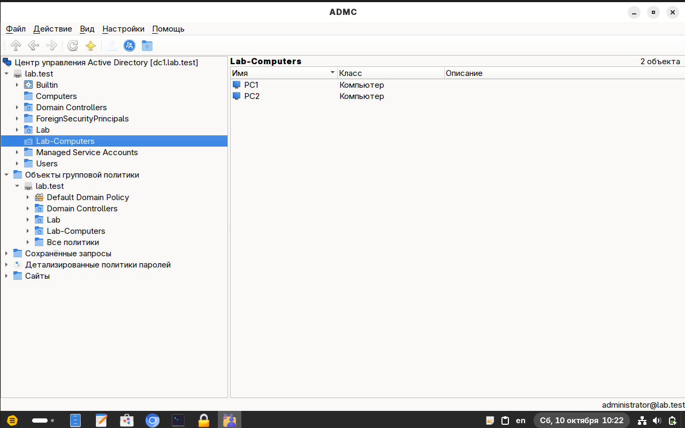
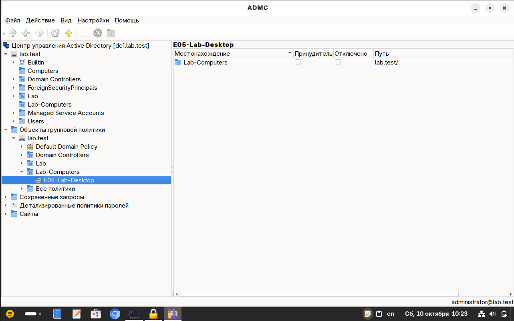
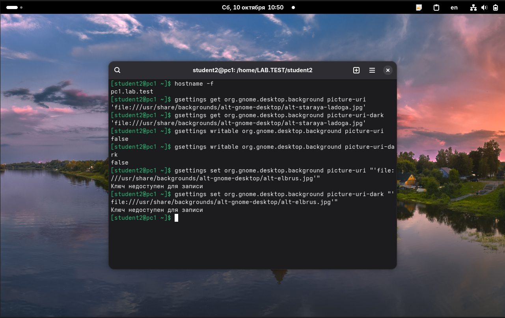
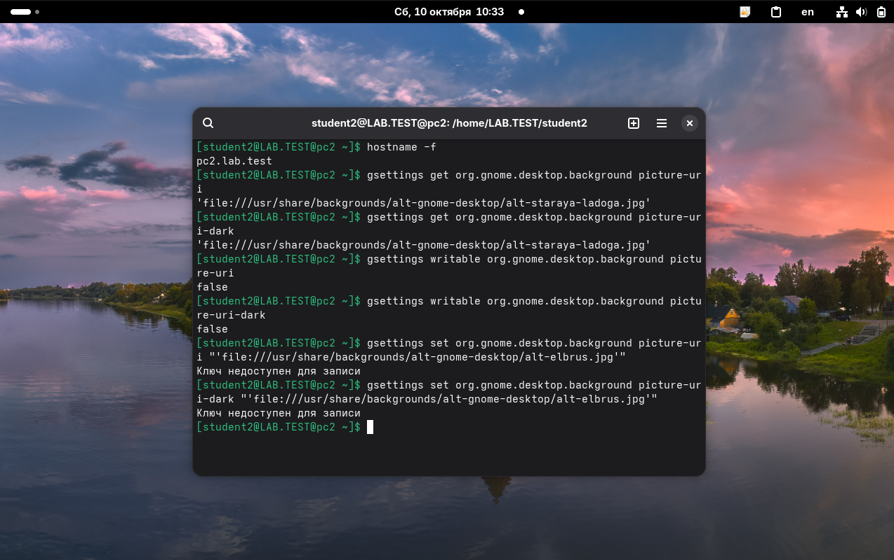
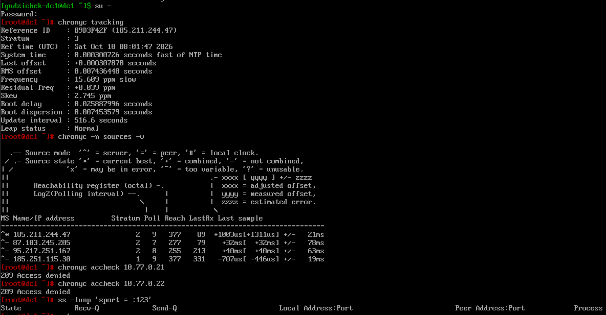
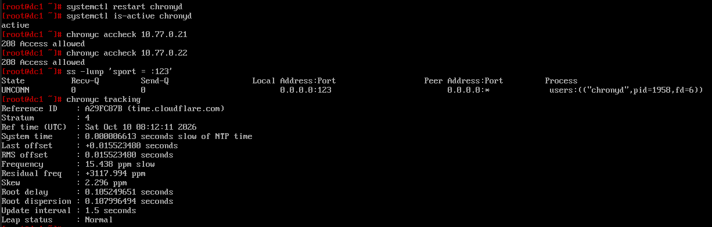
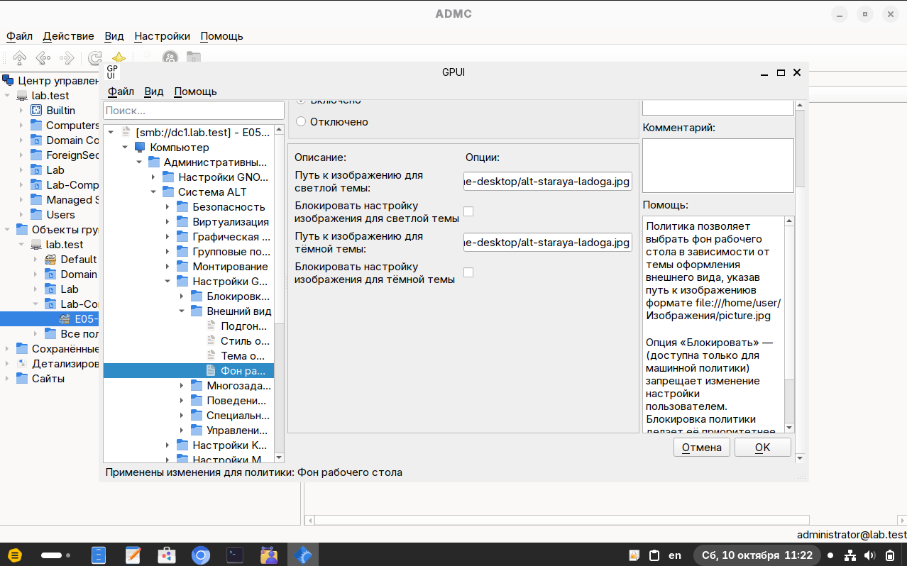
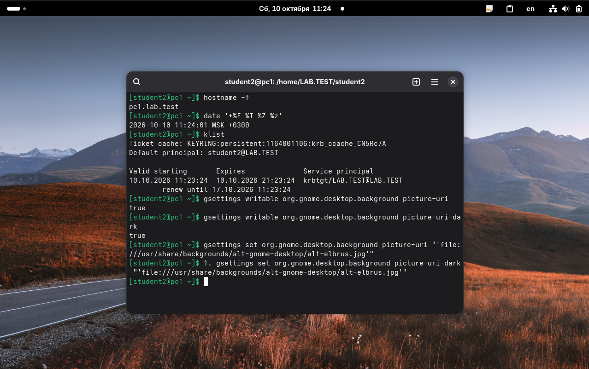
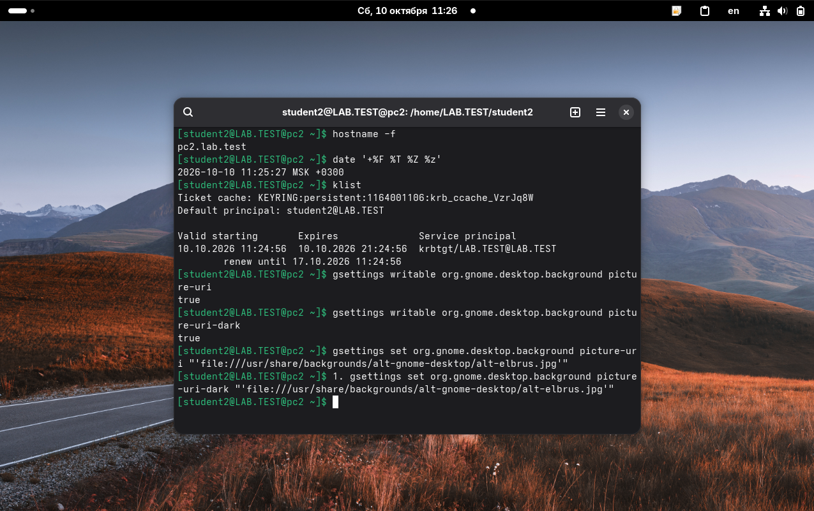

# Подтверждения за 10 октября 2026 года

Сохранены часть E05 с обоями на pc1/pc2, новый вход student2 после E09, диагностика и исправление NTP. Ограничение съёмных носителей ещё не проверено.

[Протокол E05](../../experiments/e05-desktop-wallpaper.md), [разбор времени](../../docs/time-synchronization.md), [журнал дня](../../docs/journal.md#10-октября-2026-года).

## Скриншоты

В папке 22 PNG, скопированных из переданной подборки без изменения содержимого. Все 21 ранее переданные сегодня изображения совпали по пикселям с кадрами подборки; в ней также есть отдельный кадр конфигурации Chrony. Повторные версии одного изображения не добавлялись.

Файл                                                                                     | Что подтверждает
-----------------------------------------------------------------------------------------|---------------------------------------
[01-dc1-domain-baseline.png](01-dc1-domain-baseline.png)                                 | Контроллер dc1: Samba active, домен lab.test и три компьютерные записи.
[02-pc1-student2-wallpaper-baseline.png](02-pc1-student2-wallpaper-baseline.png)         | Исходный сеанс student2 на pc1: UID, группы, HOME, Эльбрус и writable=true.
[03-pc2-student2-wallpaper-baseline.png](03-pc2-student2-wallpaper-baseline.png)         | Новый сеанс student2@LAB.TEST на pc2 после E09; те же UID/группы и исходный фон.
[04-admc-lab-computers.png](04-admc-lab-computers.png)                                   | Подразделение Lab-Computers с объектами PC1 и PC2.
[05-admc-e05-gpo-link.png](05-admc-e05-gpo-link.png)                                     | Связь E05-Lab-Desktop с Lab-Computers включена.
[06-gpui-e05-wallpaper-unlocked.png](06-gpui-e05-wallpaper-unlocked.png)                 | Компьютерная настройка фона включена, блокировки сняты.
[07-pc1-e05-wallpaper-applied.png](07-pc1-e05-wallpaper-applied.png)                     | pc1: Старая Ладога для обеих тем, writable=true.
[08-pc2-e05-wallpaper-applied.png](08-pc2-e05-wallpaper-applied.png)                     | pc2: те же значения и фон; часы ещё отстают.
[09-pc1-e05-wallpaper-user-change.png](09-pc1-e05-wallpaper-user-change.png)             | pc1: изменение фона на Эльбрус до включения запрета.
[10-pc2-e05-wallpaper-user-change.png](10-pc2-e05-wallpaper-user-change.png)             | pc2: изменение фона на Эльбрус до включения запрета.
[11-gpui-e05-wallpaper-locked.png](11-gpui-e05-wallpaper-locked.png)                     | Обе блокировки в GPUI включены, изменения применены.
[12-pc1-e05-wallpaper-change-denied.png](12-pc1-e05-wallpaper-change-denied.png)         | pc1: оба writable=false, обе записи отклонены.
[13-pc2-e05-wallpaper-change-denied.png](13-pc2-e05-wallpaper-change-denied.png)         | pc2: оба writable=false, обе записи отклонены; часы ещё неверны.
[14-dc1-time-baseline.png](14-dc1-time-baseline.png)                                     | Синхронизация времени самого dc1 подтверждена.
[15-dc1-ntp-client-access-denied.png](15-dc1-ntp-client-access-denied.png)               | Внешний NTP работает на dc1, доступ pc1/pc2 запрещён, UDP 123 не слушается.
[16-dc1-chrony-config-before-fix.png](16-dc1-chrony-config-before-fix.png)               | Конфигурация Chrony до разрешения доступа клиентов.
[17-dc1-chrony-config-editor-before-fix.png](17-dc1-chrony-config-editor-before-fix.png) | Та же конфигурация в nano; allow остаётся закомментированным примером.
[18-dc1-chrony-upstream-pool.png](18-dc1-chrony-upstream-pool.png)                       | Действующий внешний источник: pool pool.ntp.org iburst.
[19-dc1-ntp-client-access-allowed.png](19-dc1-ntp-client-access-allowed.png)             | После исправления: оба адреса разрешены, UDP 123 слушается, Normal.
[20-gpui-e05-wallpaper-locks-removed.png](20-gpui-e05-wallpaper-locks-removed.png)       | Обе галочки сняты, изменения применены, настройка остаётся включённой.
[21-pc1-e05-wallpaper-unlocked-session.png](21-pc1-e05-wallpaper-unlocked-session.png)   | pc1: новый TGT, оба writable=true, фон Эльбрус.
[22-pc2-e05-wallpaper-unlocked-session.png](22-pc2-e05-wallpaper-unlocked-session.png)   | pc2: новый TGT, оба writable=true, фон Эльбрус, правильное время.

## Текстовые подтверждения

Происхождение отмечено в каждом TXT: переданные результаты отделены от ручных расшифровок изображений. Они не названы автоматически выгруженными журналами. Отдельные изображения из текста не создавались.

Файл                                                     | Происхождение и содержание
---------------------------------------------------------|-----------------------------------------------------------------------
[dc1-baseline.txt](dc1-baseline.txt)                     | Ручная расшифровка исходного кадра контроллера.
[client-baseline.txt](client-baseline.txt)               | Переданный текст: DNS/SRV, SSSD, версии, механизм политик, новые сеансы и список обоев.
[gpupdate-computer-runs.txt](gpupdate-computer-runs.txt) | Переданные результаты обновления компьютерной политики для первого применения и включения блокировок.
[e05-wallpaper-stages.txt](e05-wallpaper-stages.txt)     | Переданный текст значений, writable и отказов записи до обратной проверки.
[pc1-e05-final-session.txt](pc1-e05-final-session.txt)   | Новый сеанс pc1 и поздняя исправленная запись тёмной темы; оба итоговых get.
[pc2-e05-final-session.txt](pc2-e05-final-session.txt)   | Новый сеанс pc2 и поздняя исправленная запись тёмной темы; оба итоговых get.
[ntp-clients-before.txt](ntp-clients-before.txt)         | Переданные результаты клиентов до исправления NTP.
[dc1-ntp-diagnostics.txt](dc1-ntp-diagnostics.txt)       | Ручная расшифровка выбранных строк dc1 и конфигурации до исправления.
[dc1-ntp-fix.txt](dc1-ntp-fix.txt)                       | Ручная расшифровка проверок dc1 после исправления доступа.
[pc1-ntp-after.txt](pc1-ntp-after.txt)                   | Переданный текст pc1 после коррекции; переход no → yes.
[pc2-ntp-after.txt](pc2-ntp-after.txt)                   | Переданный текст pc2 после коррекции и позднее подтверждение yes.
[vm-snapshots.txt](vm-snapshots.txt)                     | Точки сохранения, основание их учёта и сведения о резервной копии.

## Как читать результат E05

1. Кадры 01-03 и client-baseline.txt задают исходное состояние. На обоих клиентах student2 имеет UID 1164001106, lab-students и обычные локальные роли; на pc2 имя после E09 полное.
2. Кадры 04-06 показывают область действия GPO и настройку общего фона без запрета. Кадры 07-10 подтверждают применение и пользовательскую смену фона.
3. Кадры 11-13 показывают включённые блокировки и реальные отказы записи обоих ключей на обоих клиентах.
4. Кадры 20-22 показывают снятие блокировок и новые сеансы с writable=true и TGT. На кадрах 21/22 перед командой тёмной темы есть префикс 1.; окончательное подтверждение этой записи — исправленный текст и два get в pc1/pc2-e05-final-session.txt.

Этап                       | pc1                                            | pc2
---------------------------|------------------------------------------------|-----------------------------------------------
Исходный фон               | Эльбрус, два true                              | Эльбрус, два true
Общая настройка            | Старая Ладога, два true                        | Старая Ладога, два true
Пользовательское изменение | Эльбрус, успешно                               | Эльбрус, успешно
Блокировки                 | Старая Ладога, два false, обе записи отклонены | Старая Ладога, два false, обе записи отклонены
Снятие блокировок          | Два true; оба итоговых ключа — Эльбрус         | Два true; оба итоговых ключа — Эльбрус

Первое применение фона на pc1 видно сразу, на pc2 понадобился перезапуск — по сообщению пользователя. Причина отдельно не проверена. В итоговом состоянии GPO включена, обе блокировки сняты; удаление всей политики не проверялось.

## Как читать результат проверки времени

До исправления часы pc2 отставали примерно на 19 минут. Часовой пояс правильный; System clock synchronized=no и Not synchronised подтверждают проблему системного времени. Часы панели GNOME до исправления не используются для общей хронологии работы.

dc1 получал внешнее время, но запрещал NTP-доступ обоим клиентам и не слушал UDP 123. В его конфигурации не было действующего allow. После разрешения сети 10.77.0.0/24 оба клиента выбрали dc1 (^*), получили Normal; повторные timedatectl показали yes. Новые TGT student2 выданы в 11:23:24 на pc1 и 11:24:56 на pc2.

Кадры 14-19 относятся к dc1; клиентские результаты до и после исправления сохранены текстом. Отдельных скриншотов client tracking/timedatectl в этой подборке нет. Внешний источник dc1 менялся между измерениями; time.cloudflare.com на последнем кадре не означает ручной замены внешнего пула.

## Точки сохранения

before-e05-2026-10-10 сделан до изменений и прямо подтверждён пользователем. after-e05-wallpaper-2026-10-10 учтён для dc1/pc1/pc2 по принятому порядку выполнения просьб о снимках. Основание учёта и состояние записаны в [vm-snapshots.txt](vm-snapshots.txt). Восстановление не проверялось.

## Основные изображения

### Область применения

### Запрет изменения

### NTP до и после исправления

### Снятие блокировок и новые сеансы

